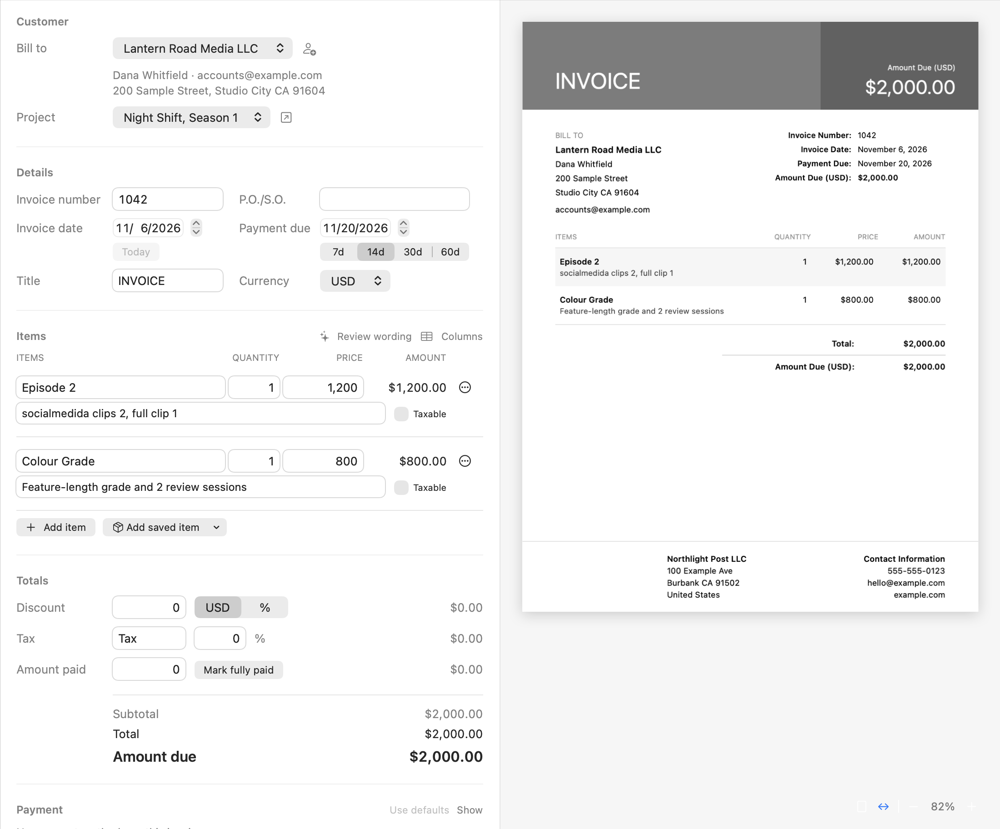
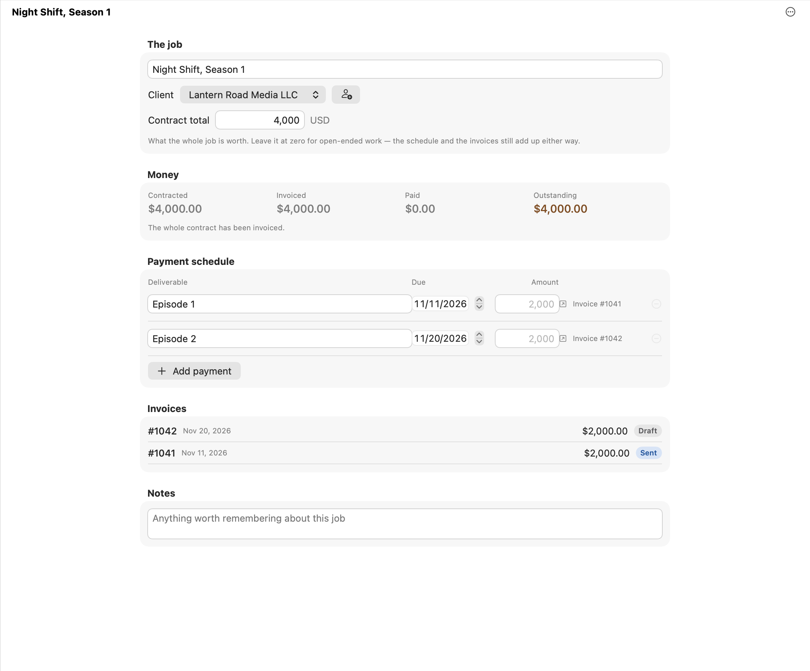
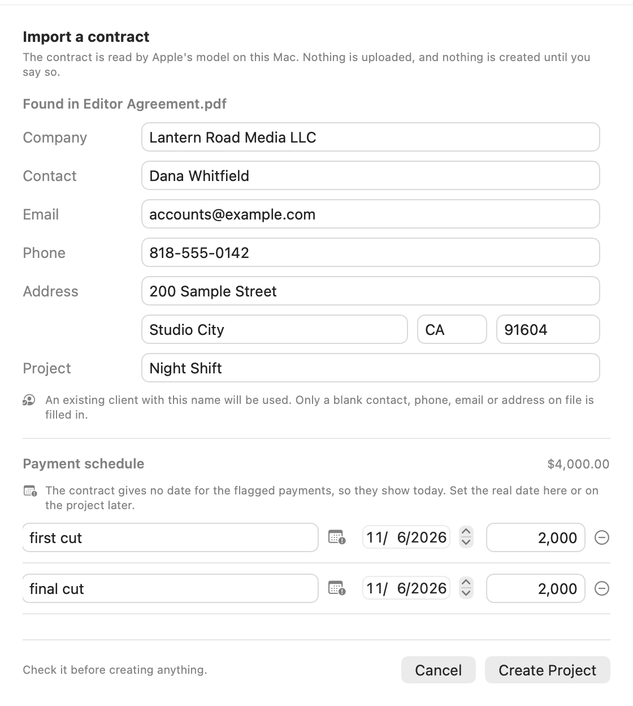
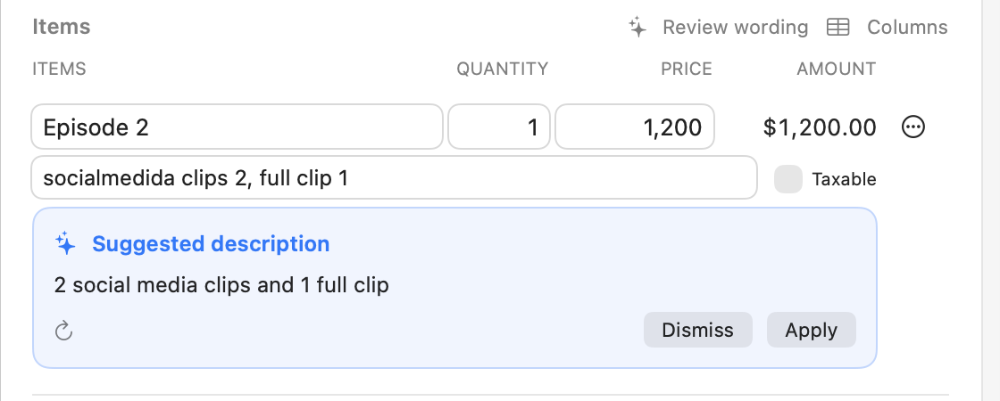

# InvoiceGen

**Invoicing that stays on your Mac.** Write, print and track invoices with no account,
no subscription, and no server holding your clients and bank details.

**[Download for macOS](https://github.com/Justbehappycat/InvoiceGen/releases/latest)** · [Website](https://invoice.finecut.com) · macOS 13 or later · Free and open source



*Edit on the left, and see the finished page on the right as you type. Everything in these screenshots is made up.*

## What you can do

- **Make invoices** with line items, discounts, tax and partial payments, then export a PDF or print.
- **Track who owes you.** Draft, Sent and Paid, with overdue flagged for you. Exporting a draft offers to mark it as sent.
- **Run a job as a project**, with a contract total, a payment schedule and its invoices in one place.
- **Import a contract** so a PDF becomes a client and a payment schedule.
- **Clean up your wording** so shorthand reads properly on a client's bill.
- **Keep payment details safe.** Bank details are encrypted, hidden until you authenticate, and every change is logged.
- **Prove an invoice wasn't edited** with a signature woven into the invoice design.

Works in light and dark, and also has saved items, templates, bulk edits, archive and trash.

## Projects

One job, its schedule, and what it still owes. Turn a scheduled payment into an invoice when it's due.



## On-device AI

These two features use Apple's model on your Mac, so nothing is uploaded. They need macOS 26 or later with Apple Intelligence turned on. The rest of the app works without them.

### Import a contract

Click **✨ Import Contract** at the bottom of the sidebar, or press ⇧⌘I, and choose a PDF. You check everything before anything is created.



- It finds the client company, contact person, email, phone and address, plus the project and each payment.
- The app does the arithmetic itself, and a total never comes from the model.
- A payment with no date, such as "payable on delivery", is flagged for you to date.
- A day or hourly rate is kept apart from the payments and saved in the project's notes, while a flat fee next to it becomes a payment.
- The PDF needs real text. A scanned contract needs OCR first.

### Review wording

Click **✨ Review wording** above your items, or just pause while typing. A suggestion appears under the line, and nothing changes until you press **Apply**.



It fixes typos and expands shorthand. Suggestions that change a number, add work you didn't list, or drop something you wrote are thrown away.

## Install

1. [Download the latest release](https://github.com/Justbehappycat/InvoiceGen/releases/latest) and unzip it.
2. Move **InvoiceGen** to Applications and open it.

Builds are signed and notarized by Apple, and the app updates itself from InvoiceGen ▸ Check for Updates…

**Build from source** (needs Xcode command line tools):

```bash
./build.sh
rm -rf /Applications/InvoiceGen.app && ditto build/InvoiceGen.app /Applications/InvoiceGen.app
```

## Your data

Everything lives on your Mac, in `~/Library/Application Support/InvoiceGen/`. The app only goes online when you choose to: **Share** publishes an invoice as a link, and updates come from GitHub Releases. Client sync through iCloud Drive is optional.

## Learn more

The [full reference](docs/DETAILS.md) covers every feature, invoice verification, how payment details are protected, updates, and how the code is laid out.
